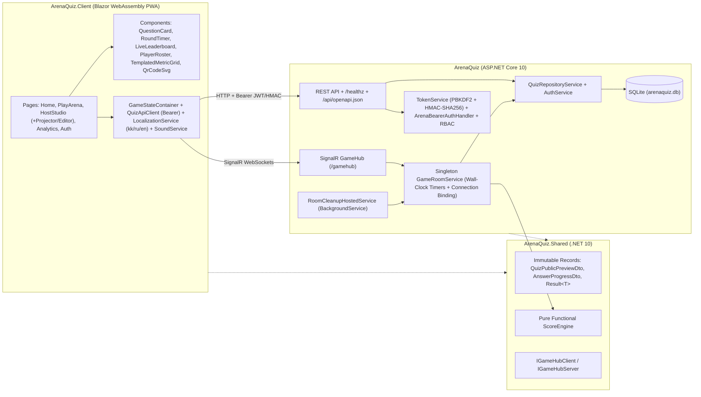
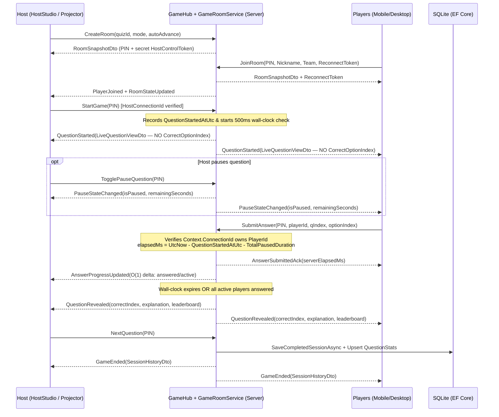
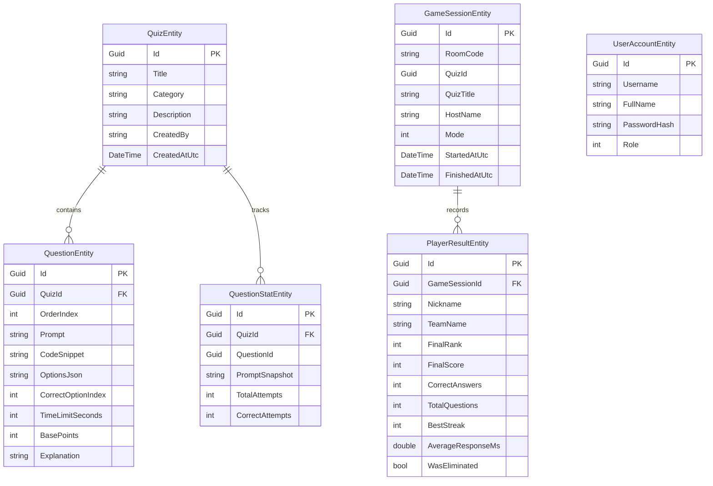

# ArenaQuiz — Real-Time Multiplayer Quiz Platform (.NET 10 Blazor WebAssembly + SignalR)

**ArenaQuiz** — кроссплатформенное веб-приложение (PWA) для проведения интерактивных викторин и академических квизов в реальном времени с серверной защитой от читерства, ролевой безопасностью (PBKDF2 + HMAC-SHA256 RBAC), тремя игровыми режимами (`ClassicSpeed`, `TeamBattle`, `KnockoutElimination`), аналитикой сложных вопросов, режимом проектора с SVG QR-кодом и экспортом результатов в RFC-4180 CSV.

---

## Команда и распределение ролей

| Участник | Роль | Зона ответственности |
|---|---|---|
| **Тамерлан Айтпаев (Tamerlan Aitpayev)** | Backend & Real-Time Security Architect | `GameHub` (SignalR + `[Authorize(Roles = "Host,Admin")]` на `CreateRoom`), `GameRoomService` (wall-clock таймеры, Pause/Resume, O(P) дельты `AnswerProgressDto`, привязка `HostConnectionId` и `HostControlToken`, `IsHostConnected`, защита от спуфинга `PlayerId` и захвата ника, `RoomCleanupHostedService`), `TokenService` (PBKDF2-SHA256 + HMAC-SHA256, обязательный ключ в `Production`), `ArenaBearerAuthHandler` (`?access_token=`), `AuthService` (`RegisterAsync`, rate limiting `429`), `AiQuizGeneratorService`, `SessionsController` (авторизованный CSV-экспорт), `ArenaDbContext` + `DbSeeder` + `QuestionStatEntity`, `WebApplicationFactory` интеграционные, security и load-тесты (`xUnit`), GitHub Actions CI. |
| **Диас Шамель (Dias Shamel)** | Frontend & Blazor WASM UI/UX Engineer | Страницы (`Home`, `HostStudio` с Fullscreen Projector, AI-генератором, 2/4 вариантами и импортом CSV/JSON, `PlayArena`, `HistoryAnalytics` со skeleton-загрузчиками, `AccessControl` с регистрацией), все локализованные компоненты (`QuestionCard`, `RoundTimer`, `LiveLeaderboard`, `PlayerRoster`, `TemplatedMetricGrid`, `ConnectionStatusBanner` с баннером переподключения хоста, `QrCodeSvg`), чистый C# QR-генератор `QrCodeEncoder`, `LocalizationService` (`kk`/`ru`/`en`), `GameStateContainer` (SignalR `AccessTokenProvider`, session recovery, Dark Mode), `SoundService` (WebAudio API), PWA (`manifest.webmanifest`, `service-worker.js`), `app.css` (0 inline-стилей), тесты (`bUnit`). |
| **Совместно** | Shared Core & Defense | `ArenaQuiz.Shared` (иммутабельные `record` DTO включая `QuizPublicPreviewDto`, движок `ScoreEngine`, монада `Result<T>`, контракты `IGameHubClient`/`IGameHubServer`), `README.md`, `docs/presentation.html`, подготовка защиты. |

---

## Архитектура системы



---

## Жизненный цикл раунда в SignalR и защита от читерства



---

## Схема базы данных (SQLite / EF Core)



---

## Безопасность, надёжность и оптимизация (v2.0)

1. **Настоящий RBAC и криптография (`TokenService`, `ArenaBearerAuthHandler`, `AuthController`)**:
   - Пароли хэшируются с помощью **PBKDF2-SHA256** (100 000 итераций, 16-байтная случайная соль, сравнение через `CryptographicOperations.FixedTimeEquals`).
   - Эндпоинты создания/редактирования квизов (`POST /api/quizzes`, `POST /api/quizzes/generate-ai`, `GET /api/quizzes/{id}/edit`, `PUT /api/quizzes/{id}`, `DELETE /api/quizzes/{id}`), экспорт результатов (`GET /api/sessions/{id}/export.csv`) и создание SignalR-комнаты (`GameHub.CreateRoom`) защищены `[Authorize(Roles = "Host,Admin")]` и подписанными **HMAC-SHA256** Bearer-токенами (через заголовок `Authorization` или `?access_token=` для SignalR `AccessTokenProvider` и скачивания CSV).
   - Клиент по умолчанию стартует с ролью `Guest Player` (`UserRole.Player`). Эндпоинт `/api/auth/quick-switch` разрешён строго для `Player`, а самостоятельная регистрация `/api/auth/register` всегда присваивает роль `UserRole.Player`.
   - **Защита от перебора паролей и production-конфигурация**: `/api/auth/login` ограничивает неудачные попытки входа (5 ошибок в минуту -> HTTP `429 Too Many Requests`). В `Production`-окружении `TokenService` требует обязательного задания `Security:TokenSigningKey` при старте, а сид демо-аккаунтов в `DbSeeder` отключается (если явно не задан `ARENAQUIZ_SEED_DEMO=1`).
2. **Защита от утечки ответов**:
   - Публичный эндпоинт `GET /api/quizzes/{id}` возвращает `QuizPublicPreviewDto` (`QuestionPublicDto`) — без `CorrectOptionIndex` и `Explanation`. Полная структура `QuizDetailDto` доступна только авторизованному `Host` на `/api/quizzes/{id}/edit`.
3. **Защита SignalR Hub (`GameHub`, `GameRoomService`)**:
   - Создание комнаты (`CreateRoom`) требует `[Authorize(Roles = "Host,Admin")]`; все управляющие действия хоста (`StartGame`, `TogglePauseQuestion`, `RevealCurrentQuestion`, `NextQuestion`, `RemovePlayer`) проверяют `room.HostConnectionId == callerConnectionId`.
   - При обновлении вкладки хоста клиент автоматически вызывает `ReclaimHost(roomCode, hostControlToken)` с постоянным сравнением токена, а во время обрыва связи игрокам отображается баннер `IsHostConnected == false` («Host is reconnecting...»).
   - `SubmitAnswer` и `SendReaction` привязаны к `Context.ConnectionId` (исключена подмена чужого `PlayerId` или ника), а реакции ограничены по частоте (не чаще 1 раза в 1.5 сек на соединение).
   - Повторный вход под ником отключённого игрока без секретного `ReconnectToken` блокируется.
4. **Надёжность, UX и трафик**:
   - **Wall-clock таймер**: проверка каждые 500 мс относительно `QuestionStartedAtUtc` и `TotalPausedDuration` исключает дрейф таймера, поддерживает паузу и визуальный пульс на последних 5 секундах.
   - **O(P) дельты вместо O(P²)**: при отправке ответов сервер рассылает компактный `AnswerProgressUpdated` (`AnsweredCount / TotalActivePlayers`) вместо повторной сериализации всего `RoomSnapshotDto`.
   - **Фоновая очистка (`RoomCleanupHostedService`)**: каждые 2 минуты удаляет завершённые (`> 15 мин`) и брошенные (`> 30 мин`) комнаты и освобождает их таймеры.
   - **Справедливый Knockout**: при случайном обрыве сети отключённый игрок не выбывает на таймауте вопроса; выбывают только подключённые игроки, давшие неверный ответ или не успевшие ответить вовремя.
   - **Проекция в SQL и продуктивность**: `GetAllQuizSummariesAsync` выбирает количество вопросов в SQL `.Select(...)`, все UI-компоненты переведены на `kk`/`ru`/`en`, отображают аватары `ScoreEngine.GetPlayerAvatar` и skeleton-загрузчики.

---

## Анализ алгоритмической сложности (Big-O)

| Операция | Реализация | Временная сложность | Пространственная сложность |
|---|---|---|---|
| Поиск комнаты по 6-значному PIN | `ConcurrentDictionary<string, ActiveRoomState>` | $O(1)$ в среднем | $O(R)$, где $R$ — активные комнаты |
| Расчёт очков за ответ (`ScoreEngine.CalculateAnswerScore`) | Чистая функция | $O(1)$ | $O(1)$ |
| Уведомление о прогрессе ответов | `AnswerProgressDto` (дельта вместо полного снапшота) | $O(1)$ на сервере, $O(P)$ рассылка за вопрос | $O(1)$ |
| Построение лидерборда (`ScoreEngine.ComputeLeaderboard`) | `OrderBy` / `ThenByDescending` | $O(P \log P)$ | $O(P)$ |
| Агрегация команд (`ScoreEngine.ComputeTeamStandings`) | `GroupBy` по `TeamSide` | $O(P + T \log T), T \le 3$ | $O(P)$ |
| Экспорт результатов в CSV (`ScoreEngine.BuildSessionCsv`) | Однопроходный RFC-4180 | $O(P)$ | $O(P)$ |

---

## Масштабирование (Честная архитектура)

Сейчас `ActiveRoomState` и таймеры раундов (`System.Threading.Timer`) хранятся в памяти одного ASP.NET Core процесса (`ConcurrentDictionary`), что оптимально для одного сервера аудитории/университета без внешней инфраструктуры.  
Для горизонтального масштабирования на несколько нод за балансировщиком одного лишь SignalR Redis Backplane **недостаточно** — потребуется:
1. **SignalR Redis Backplane** (или **Azure SignalR Service**) для маршрутизации WebSocket-сообщений между серверами.
2. **Вынос состояния комнат в Redis** (распределённые хэши/блокировки Redis вместо in-process `ConcurrentDictionary`) и перенос тиков таймера на распределённый воркер/отложенные задачи.
3. **Миграция БД с SQLite на PostgreSQL** для конкурентной записи с нескольких инстансов.

---

## Руководство пользователя и API

### Для ведущего (Host)
1. Перейдите на `/auth`, введите учётные данные (`tamerlan` / `host123` или `dias` / `host123`) и нажмите **Sign In**.
2. Откройте `/host` (**Host Studio**). Во вкладке **Quiz Editor** можно создавать новые квизы (включая **2 Options (True/False)** и **4 Options**), генерировать черновик по теме на сервере (**Generate AI Quiz Draft** -> Anthropic API или встроенный шаблон), загружать и редактировать существующие, менять порядок вопросов (`Up`/`Down`), дублировать и импортировать/экспортировать **JSON** и **CSV**.
3. Во вкладке **Live Game Console** выберите квиз и режим (`Classic Speed`, `Team Battle`, `Knockout`), затем создайте комнату.
4. Откройте **Projector View** (с кнопкой **Fullscreen** API) для демонстрации гигантского PIN и SVG QR-кода аудитории. Во время вопроса можно нажать **Pause Timer** / **Resume Timer** или досрочно открыть правильный ответ (**Reveal Answer Now**).

### Для игрока (Player)
1. Отсканируйте QR-код с экрана ведущего или откройте `/` (или `/play`), введите 6-значный PIN и свой ник (можно также зарегистрировать личный аккаунт игрока на `/auth` или выбрать открытое лобби одним нажатием).
2. Подключитесь с телефона, планшета или ноутбука. Переключатель темы (Light/Dark) и языка (`EN` / `RU` / `KZ`) доступен в верхней панели навигации и переводит как страницы, так и все компоненты игры.
3. При потере Wi-Fi обновите страницу — сессия восстановится по `ReconnectToken` с сохранением набранных баллов.

### Диагностика и эндпоинты
- `GET /healthz` — Liveness Health Check сервера.
- `GET /api/openapi.json` — Сводная OpenAPI 3.0.3 спецификация API.
- `POST /api/auth/register` — Регистрация нового аккаунта с ролью `Player`.
- `POST /api/quizzes/generate-ai` — Генерация черновика квиза по теме (только `Host`/`Admin`).
- `GET /api/sessions/{id}/export.csv` — Скачивание отчёта завершённой сессии в RFC-4180 CSV (только `Host`/`Admin`, поддерживает `Authorization: Bearer` и `?access_token=`).

---

## Инструкция по запуску и тестированию

### Требования
- [.NET 10 SDK](https://dotnet.microsoft.com/) (проверено на `10.0.401`)

### Запуск приложения
```bash
dotnet restore ArenaQuiz.sln
dotnet run --project ArenaQuiz/ArenaQuiz.csproj
```
В `Development`-среде демо-база `arenaquiz.db` автоматически создаётся и заполняется 3 квизами, историей игр, статистикой вопросов и демо-аккаунтами (`tamerlan`/`host123`, `dias`/`host123`, `student`/`play123`). В `Production` сид демо-аккаунтов отключён (включается только при `ARENAQUIZ_SEED_DEMO=1`), а `Security:TokenSigningKey` обязателен к настройке.

### Запуск тестов, нагрузки и CI (xUnit + bUnit + WebApplicationFactory + SignalR)
```bash
dotnet test ArenaQuiz.sln --configuration Release --collect:"XPlat Code Coverage" --logger "console;verbosity=normal"
```
Текущий набор: **38 / 38 автоматических тестов** (включая нагрузочный тест на 100 одновременных игроков, SignalR `[Authorize]`, `429` rate limiting и авторизацию CSV/AI). Покрытие Cobertura: **91.8%** (`ArenaQuiz.Shared`), **86.0%** (`ArenaQuiz` Server). Автоматический запуск настроен в [`.github/workflows/ci.yml`](.github/workflows/ci.yml).
