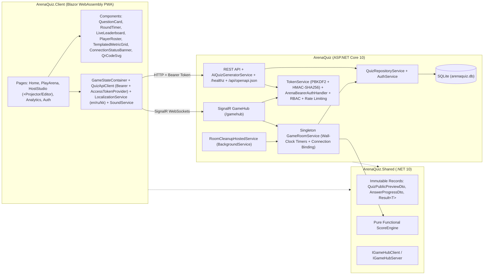
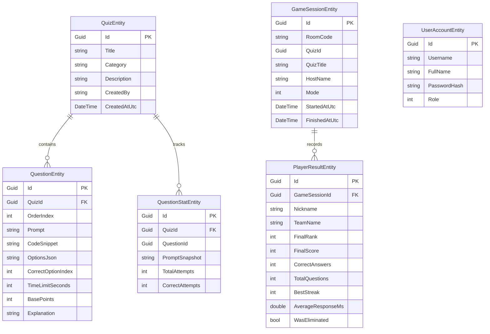

# ArenaQuiz — Real-Time Multiplayer Quiz Platform (.NET 10 Blazor WebAssembly + SignalR)

[](https://github.com/tamerlanaitpayev1-netizen/IFP-FINAL/actions/workflows/ci.yml)

**ArenaQuiz** is a cross-platform Progressive Web App (PWA) built with **ASP.NET Core 10**, **Blazor WebAssembly**, **SignalR**, and **EF Core SQLite** for real-time academic lectures, interactive classroom assessments, and team competitions. It delivers server-authoritative anti-cheat timing, cryptographic PBKDF2 + HMAC-SHA256 role-based access control (RBAC), three game modes (`ClassicSpeed`, `TeamBattle`, `KnockoutElimination`), hardest-question telemetry, a Fullscreen Projector mode with offline ISO/IEC 18004 SVG QR join codes, server-side AI quiz draft generation, and RFC-4180 CSV export.

- **GitHub Repository:** https://github.com/tamerlanaitpayev1-netizen/IFP-FINAL
- **Defense Slide Deck:** [`docs/ArenaQuiz_Presentation.pdf`](docs/ArenaQuiz_Presentation.pdf) ([interactive HTML version](docs/presentation.html))

---

## Team & Role Distribution

| Member | Role | Areas of Responsibility |
|---|---|---|
| **Tamerlan Aitpayev** | Backend & Real-Time Security Architect | SignalR `GameHub` (`[Authorize(Roles = "Host,Admin")]` on `CreateRoom`), `GameRoomService` (wall-clock timers, Pause/Resume, $O(P)$ `AnswerProgressDto` deltas, `HostConnectionId` & `HostControlToken` binding, `IsHostConnected` status tracking, anti-spoofing on `PlayerId`/`ConnectionId`, nickname hijack prevention, `RoomCleanupHostedService`), `TokenService` (PBKDF2-SHA256 + HMAC-SHA256 with mandatory Production signing key), `ArenaBearerAuthHandler` (`Authorization` header + `?access_token=`), `AuthService` (`RegisterAsync`, login `429` rate limiting), `AiQuizGeneratorService`, authorized CSV export (`SessionsController`), `ArenaDbContext` + `DbSeeder` + `QuestionStatEntity`, `WebApplicationFactory` security & 100-player load tests (`xUnit`), and GitHub Actions CI ([`.github/workflows/ci.yml`](.github/workflows/ci.yml)). |
| **Dias Shamel** | Frontend & Blazor WASM UI/UX Engineer | Routed pages (`Home`, `HostStudio` with Projector Fullscreen API, AI Draft generator, 2/4-option editor, and JSON/CSV bulk import, `PlayArena`, `HistoryAnalytics` with skeleton loaders & authorized CSV export, `AccessControl` with player self-registration), localized reusable components (`QuestionCard`, `RoundTimer`, `LiveLeaderboard`, `PlayerRoster`, `TemplatedMetricGrid`, `ConnectionStatusBanner` with host-reconnecting alert, `QrCodeSvg`), pure-C# `QrCodeEncoder`, `LocalizationService` (`en` / `ru` / `kk`), `GameStateContainer` (SignalR `AccessTokenProvider`, session recovery, Dark Mode), `SoundService` (WebAudio API), PWA (`manifest.webmanifest`, `service-worker.js`), `app.css` (0 inline `style=""` attributes across all `.razor` files), and `bUnit` component tests. |
| **Joint** | Shared Core & Final Defense | `ArenaQuiz.Shared` (immutable `sealed record` DTOs including `QuizPublicPreviewDto`, functional `ScoreEngine` with deterministic emoji avatars, `Result<T>` monad, strongly typed `IGameHubClient` / `IGameHubServer` contracts), `README.md`, HTML/PDF presentation slides, and defense preparation. |

---

## System Architecture



---

## Real-Time SignalR Round Lifecycle & Anti-Cheat Protocol


---

## Relational Database Schema (EF Core + SQLite)



---

## Security, Reliability & Performance Engineering (v2.0)

1. **Real Cryptography & RBAC (`TokenService`, `ArenaBearerAuthHandler`, `AuthController`)**:
   - Passwords are hashed using **PBKDF2-SHA256** (100,000 iterations, 16-byte cryptographic random salt, compared via `CryptographicOperations.FixedTimeEquals`).
   - Quiz mutations & editor detail (`POST /api/quizzes`, `POST /api/quizzes/generate-ai`, `GET /api/quizzes/{id}/edit`, `PUT /api/quizzes/{id}`, `DELETE /api/quizzes/{id}`), CSV match exports (`GET /api/sessions/{id}/export.csv`), and SignalR room creation (`GameHub.CreateRoom`) are protected by `[Authorize(Roles = "Host,Admin")]` with **HMAC-SHA256** signed Bearer tokens (via `Authorization: Bearer ...` or `?access_token=` for SignalR `AccessTokenProvider` and browser CSV downloads).
   - Clients default to a low-privilege `Guest Player` (`UserRole.Player`) session. `/api/auth/quick-switch` is strictly restricted to `Player` accounts, while self-service registration (`/api/auth/register`) ignores elevated client roles and always creates `UserRole.Player`.
   - **Brute-Force Protection & Production Hardening**: `POST /api/auth/login` enforces a per-username sliding rate limit (5 failed attempts/minute -> HTTP `429 Too Many Requests`). In `Production`, `TokenService` fails fast on startup if `Security:TokenSigningKey` is missing, and `DbSeeder` disables demo user seeding unless `ARENAQUIZ_SEED_DEMO=1` is explicitly configured.
2. **Zero Answer-Key Leakage**:
   - Public `GET /api/quizzes/{id}` returns `QuizPublicPreviewDto` (`QuestionPublicDto`) — completely omitting `CorrectOptionIndex` and `Explanation`. Answer keys for editing are served exclusively over authorized `/api/quizzes/{id}/edit`, and live questions use `LiveQuestionViewDto` until the round reveal.
3. **SignalR Hub Integrity (`GameHub`, `GameRoomService`)**:
   - `CreateRoom` requires `Host`/`Admin` claims; in-game lifecycle controls (`StartGame`, `TogglePauseQuestion`, `RevealCurrentQuestion`, `NextQuestion`, `RemovePlayer`) enforce `room.HostConnectionId == callerConnectionId`.
   - If the host refreshes or briefly loses connectivity, `IsHostConnected` becomes `false` (displaying an amber *"Host is reconnecting..."* banner to players), and the host browser automatically restores control via `ReclaimHost(roomCode, hostControlToken)` using constant-time comparison.
   - `SubmitAnswer` and `SendReaction` resolve player identity strictly from `Context.ConnectionId` (rejecting spoofed `PlayerId` payloads) with a 1.5s per-connection reaction cooldown.
   - Rejoining under an occupied/disconnected nickname without a matching `ReconnectToken` is blocked to prevent session hijacking.
4. **Reliability, UX Polish & Bandwidth Efficiency**:
   - **Wall-Clock Timer**: Polling every 500 ms against `QuestionStartedAtUtc` and `TotalPausedDuration` eliminates timer drift across pauses, driving an urgent visual pulse during the final 5 seconds.
   - **$O(P)$ Incremental Deltas**: Submitting answers broadcasts lightweight `AnswerProgressUpdated` counts instead of re-serializing the full `RoomSnapshotDto` on every click (avoiding $O(P^2)$ fanout traffic).
   - **Background Room Eviction (`RoomCleanupHostedService`)**: Sweeps every 2 minutes to evict finished rooms (`> 15 min`) and abandoned lobbies (`> 30 min`), disposing their timers.
   - **Fair Knockout Mode**: Players whose WebSocket unexpectedly drops are not eliminated on question timeout; only connected players who submit an incorrect answer or time out while online are eliminated.
   - **UI Localization, Accessibility & Query Projection**: `GetAllQuizSummariesAsync` computes question counts directly in SQL `.Select(...)`; all pages and reusable components support `EN / RU / KK`, deterministic emoji player avatars (`ScoreEngine.GetPlayerAvatar`), skeleton loaders, celebratory podium animations, Light/Dark themes, and contain **0 inline `style=""` attributes** across all `.razor` files.

---

## Algorithmic Complexity Analysis (Big-O)

| Operation | Implementation | Time Complexity | Space Complexity |
|---|---|---|---|
| Room lookup by 6-char PIN | `ConcurrentDictionary<string, ActiveRoomState>` | $O(1)$ average | $O(R)$ active rooms |
| Answer score calculation (`ScoreEngine.CalculateAnswerScore`) | Pure function (speed curve + capped `+50%` streak) | $O(1)$ | $O(1)$ |
| Answer progress broadcast | `AnswerProgressDto` (delta instead of full snapshot) | $O(1)$ server, $O(P)$ broadcast per question | $O(1)$ |
| Leaderboard sorting (`ScoreEngine.ComputeLeaderboard`) | `OrderBy` / `ThenByDescending` | $O(P \log P)$ | $O(P)$ |
| Team aggregation (`ScoreEngine.ComputeTeamStandings`) | `GroupBy` over `TeamSide` ($T \le 3$) | $O(P)$ | $O(P)$ |
| Match CSV export (`ScoreEngine.BuildSessionCsv`) | Single-pass RFC-4180 writer | $O(P)$ | $O(P)$ |

---

## Horizontal Scaling Architecture

In the current single-server deployment, `ActiveRoomState` and `System.Threading.Timer` instances live in memory inside a process-local `ConcurrentDictionary`, which keeps latency minimal and avoids external infrastructure dependencies for university classrooms.  
True multi-instance horizontal scaling behind a load balancer requires **more than a SignalR Redis Backplane alone**:
1. **SignalR Redis Backplane** (or **Azure SignalR Service**) to route WebSocket fanout across server nodes.
2. **Distributed Room State in Redis** (distributed hashes/locks replacing in-process `ConcurrentDictionary` and distributed timer workers).
3. **Database Migration from SQLite to PostgreSQL** for concurrent multi-writer persistence.

---

## User Guide & API Reference

### Host Workflow
1. Navigate to `/auth`, sign in (`tamerlan` / `host123` or `dias` / `host123` in Development), or manage Host credentials.
2. Open `/host` (**Host Studio**):
   - **Quiz Editor tab**: create quizzes with **4 Options (Multiple Choice)** or **2 Options (True / False)**, generate topic-tailored drafts via **Generate AI Quiz Draft** (`POST /api/quizzes/generate-ai`, backed by Claude API when `Anthropic:ApiKey` / `ANTHROPIC_API_KEY` is configured or structured server-side generation), reorder questions (`MoveUp`/`MoveDown`), duplicate, edit existing decks, or bulk-import/export **JSON** and **CSV**.
   - **Live Game Console tab**: pick a quiz and mode (`Classic Speed`, `Team Battle`, `Knockout`), then create a live room PIN.
3. Open **Projector View** (with native **Fullscreen** API toggle) to display the giant Room PIN and offline SVG QR code. During questions, use **Pause / Resume Timer** or **Reveal Answer Now**.

### Player Workflow
1. Scan the projector QR code or visit `/` (`/play`), enter the 6-character PIN and a nickname (or register an account on `/auth` / click any open lobby card).
2. Switch Light/Dark themes or languages (`EN` / `RU` / `KZ`) at any time from the navigation bar; both pages and live components update immediately.
3. If your browser reloads or drops Wi-Fi, reconnecting restores your score and active session automatically via `ReconnectToken`.

### HTTP & Diagnostic Endpoints
- `GET /healthz` — Server health check endpoint.
- `GET /api/openapi.json` — OpenAPI 3.0.3 API specification.
- `POST /api/auth/register` — Public player account registration (always assigns `UserRole.Player`).
- `POST /api/auth/login` — Credential verification (`429` after 5 failed attempts/minute).
- `POST /api/quizzes/generate-ai` — Topic-based AI quiz draft generator (`Host`/`Admin` only).
- `GET /api/sessions/{id}/export.csv` — Completed session RFC-4180 CSV download (`Host`/`Admin` only via `Bearer` header or `?access_token=`).

---

## Build, Automated Tests & CI

### Prerequisites
- [.NET 10 SDK](https://dotnet.microsoft.com/)

### Run Locally
```bash
dotnet restore ArenaQuiz.sln
dotnet run --project ArenaQuiz/ArenaQuiz.csproj
```
In `Development`, `arenaquiz.db` is automatically initialized and seeded with 3 sample quizzes, historical match analytics, question difficulty telemetry, and demo accounts (`tamerlan`/`host123`, `dias`/`host123`, `student`/`play123`). In `Production`, demo account seeding is disabled unless `ARENAQUIZ_SEED_DEMO=1` is set and `Security:TokenSigningKey` must be configured.

### Run Automated Test Suite & Coverage (`xUnit` + `bUnit` + `WebApplicationFactory` + SignalR + Load Test)
```bash
dotnet test ArenaQuiz.sln --configuration Release --collect:"XPlat Code Coverage" --logger "console;verbosity=normal"
```
- **Test Results:** **38 / 38 automated tests passing** in Release mode (`ScoreEngineTests`, `GameRoomServiceTests`, `QuizRepositorySqliteTests`, `BlazorComponentsBunitTests`, and `ServerSecurityAndApiIntegrationTests` including SignalR `[Authorize]`, CSV & AI authorization, `/api/auth/register`, `429` login rate limiting, and a **100-concurrent-player room load test**).
- **Measured Cobertura Coverage:** **91.8%** line coverage in `ArenaQuiz.Shared` and **86.0%** line coverage in `ArenaQuiz` Server.
- **Continuous Integration:** Automated builds and coverage runs execute on every push and pull request to `main` via [`.github/workflows/ci.yml`](.github/workflows/ci.yml).
