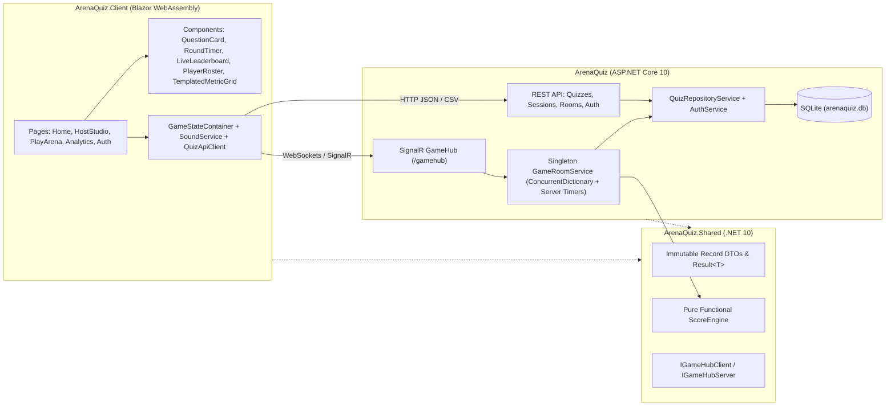
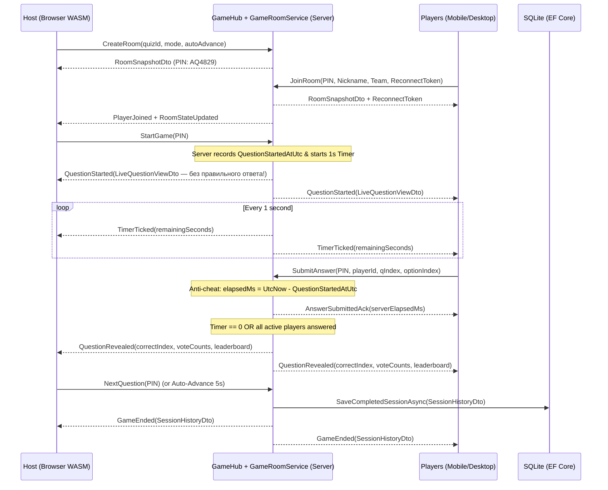
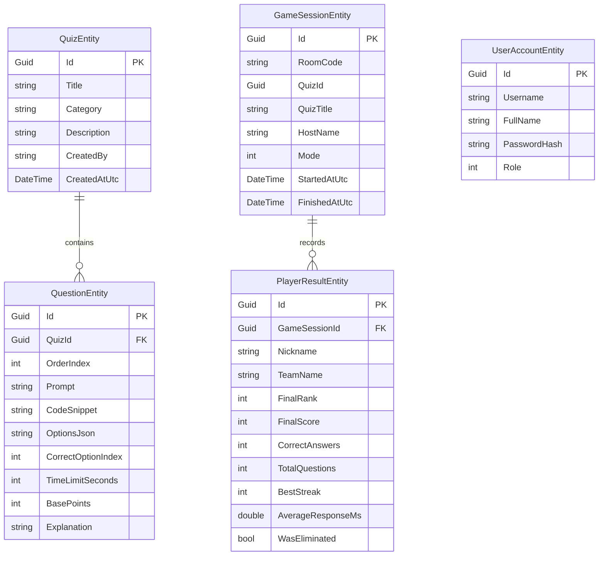

# ArenaQuiz — Real-Time Multiplayer Quiz Platform (.NET 10 Blazor WebAssembly + SignalR)

**ArenaQuiz** — кроссплатформенное веб-приложение для проведения интерактивных викторин и академических квизов в реальном времени с защитой от читерства, тремя игровыми режимами (`ClassicSpeed`, `TeamBattle`, `KnockoutElimination`), сохранением истории в SQLite, ролевой моделью доступа (RBAC) и экспортом отчётов в CSV.

---

## Команда и распределение ролей

| Участник | Роль | Зона ответственности |
|---|---|---|
| **Тамерлан** (Student A) | Backend & Real-Time Architect | `GameHub` (SignalR), `GameRoomService` (многокомнатный state, серверные таймеры, защита от читерства), `ArenaDbContext` + `DbSeeder` (EF Core + SQLite), `AuthService` (RBAC), REST API контроллеры, серверные интеграционные и unit-тесты (`xUnit`). |
| **Диас** (Student B) | Frontend & Blazor WASM Engineer | Страницы (`Home`, `HostStudio`, `PlayArena`, `HistoryAnalytics`, `AccessControl`), переиспользуемые и шаблонные компоненты (`QuestionCard`, `RoundTimer`, `LiveLeaderboard`, `PlayerRoster`, `TemplatedMetricGrid`, `ConnectionStatusBanner`), `GameStateContainer`, `SoundService` (WebAudio API), адаптивный UI/CSS, тесты компонентов (`bUnit`). |
| **Совместно** | Shared Core & Defense | `ArenaQuiz.Shared` (иммутабельные `record` DTO, функциональный движок `ScoreEngine`, монада `Result<T>`, контракты `IGameHubClient`/`IGameHubServer`), документация, презентация, репетиция защиты. |

---

## Архитектура системы



---

## Жизненный цикл раунда в SignalR



---

## Схема базы данных (SQLite / EF Core)



---

## Анализ алгоритмической сложности (Big-O)

| Операция | Реализация | Временная сложность | Пространственная сложность |
|---|---|---|---|
| Поиск комнаты по 6-значному PIN | `ConcurrentDictionary<string, ActiveRoomState>` | $O(1)$ в среднем | $O(R)$, где $R$ — число активных комнат |
| Расчёт очков за ответ (`ScoreEngine.CalculateAnswerScore`) | Чистая функция без побочных эффектов | $O(1)$ | $O(1)$ |
| Построение лидерборда (`ScoreEngine.ComputeLeaderboard`) | LINQ `OrderBy` / `ThenByDescending` (IntroSort) | $O(P \log P)$, где $P$ — число игроков в комнате | $O(P)$ |
| Агрегация команд (`ScoreEngine.ComputeTeamStandings`) | LINQ `GroupBy` по `TeamSide` | $O(P + T \log T)$, где $T \le 3$ | $O(P)$ |
| Балансировка команды (`ScoreEngine.AssignBalancedTeam`) | Подсчёт через `GroupBy` + выбор минимума | $O(P)$ | $O(T)$ |
| Экспорт результатов в CSV (`ScoreEngine.BuildSessionCsv`) | Однопроходная сериализация RFC-4180 | $O(P)$ | $O(P)$ |

---

## Инструкция по запуску и тестированию

### Требования
- [.NET 10 SDK](https://dotnet.microsoft.com/) (проверено на `10.0.401`)

### Запуск приложения
```bash
dotnet restore ArenaQuiz.sln
dotnet run --project ArenaQuiz/ArenaQuiz.csproj
```
После запуска откройте адрес из консоли (например, `https://localhost:5001` или `http://localhost:5000`).  
База данных `arenaquiz.db` создаётся и автоматически заполняется демонстрационными квизами, историей игр и аккаунтами (`tamerlan`/`host123`, `dias`/`host123`, `student`/`play123`) при первом старте.

### Запуск автоматических тестов (xUnit + SQLite + bUnit)
```bash
dotnet test ArenaQuiz.sln --configuration Release --logger "console;verbosity=normal"
```

---

## Соответствие критериям оценивания (20 × 5% = 100%)

1. **Code Structure & Design**: Чёткое разделение `ArenaQuiz.Shared` / `ArenaQuiz` / `ArenaQuiz.Client` / `ArenaQuiz.Tests`, интерфейс `IGameRoomBroadcaster` (DIP), сервисный слой.
2. **Component Reusability**: 6 изолированных компонентов (`QuestionCard`, `RoundTimer`, `LiveLeaderboard`, `PlayerRoster`, `TemplatedMetricGrid<TItem>`, `ConnectionStatusBanner`) с `[Parameter]` и `EventCallback<T>`.
3. **Cross-Platform Compatibility**: Запускается на Windows, macOS, Linux (.NET 10) и в любом современном мобильном/десктопном браузере (WebAssembly).
4. **State Management**: Централизованный `GameStateContainer` + `<CascadingValue Value="GameState" IsFixed="true">` + сохранение токена переподключения в `sessionStorage`.
5. **User Interface (UI) Design**: Единая дизайн-система на CSS-переменных, высокая контрастность WCAG AA, табличные цифры (`tabular-nums`), SVG-иконки.
6. **User Experience (UX)**: Мгновенный вход по 6-значному PIN с главной страницы, список открытых лобби, понятная обратная связь при ответах.
7. **Responsiveness**: Адаптивная сетка (`aq-grid-2/3/4`) и медиа-запросы для экранов от 360px до 4K, удобные кнопки ответа от `60px` высоты на телефоне.
8. **Core Functionality**: Создание квизов, запуск комнат, вход игроков, лобби, живой таймер, скорость-зависимые очки, лидерборд, подиум, история игр.
9. **Advanced Features**: SignalR с типизированным хабом `Hub<IGameHubClient>`, 3 режима (`ClassicSpeed`, `TeamBattle`, `KnockoutElimination`), RBAC (`Host`/`Player`), WebAudio-звуки, RFC-4180 CSV-экспорт.
10. **Error Handling & Resilience**: Функциональная монада `Result<T>`, автоматическое переподключение SignalR (`WithAutomaticReconnect`), восстановление сессии по `ReconnectToken`.
11. **Efficiency**: Отдача `LiveQuestionViewDto` без лишних полей, `AsNoTracking()` в EF Core-запросах, минимальный трафик по WebSockets.
12. **Scalability**: Потокобезопасное хранилище комнат `ConcurrentDictionary` с гранулярной блокировкой на комнату; готовность к Redis Backplane / Azure SignalR Service.
13. **Resource Utilization**: Остановка и освобождение `System.Threading.Timer` по окончании раунда, отсутствие polling-запросов.
14. **Testing Coverage**: Модульные тесты `ScoreEngineTests`, интеграционные тесты комнат `GameRoomServiceTests`, тесты SQLite `QuizRepositorySqliteTests`, тесты UI-компонентов `BlazorComponentsBunitTests`.
15. **Quality Assurance**: Сборка в `Release` без ошибок, проверка эндпоинтов и ручная кросс-браузерная проверка на телефоне и ПК.
16. **Documentation**: `README.md` с Mermaid-диаграммами, Big-O анализом, `docs/PRESENTATION_SLIDES.md`, `docs/DEFENSE_QA_GUIDE.md`, `docs/TEAM_GIT_WORKFLOW.md`.
17. **Innovation**: Защита от читерства через серверный расчёт времени и скрытие индекса правильного ответа на клиенте + режим выбывания Knockout.
18. **Creative Use of Blazor/C#/.NET Features**: Иммутабельные `record`-ы с `with`-выражениями, switch expressions, `Result<T>`, `RenderFragment<TItem>` (`TemplatedMetricGrid`), `CascadingValue`, WebAudio JS Interop.
19. **Professionalism**: Чистый `.gitignore`, отсутствие мусора, воспроизводимый seed базы данных.
20. **Presentation**: Готовая структура слайдов и шпаргалка ответов на вопросы комиссии в папке `docs/`.

